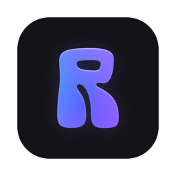

  

<h1 align="center">Reshape for macOS</h1>

  Design true to the web. Compose with components and styles, craft with breakpoints and states, 
  and deliver React with pure CSS or Tailwind. Your coding agents work right next to the canvas.

  <a href="https://github.com/reshape-design/releases/releases/latest/download/Reshape-arm64.dmg"><strong>Download for macOS</strong></a>
  &nbsp;·&nbsp;
  <a href="https://www.reshape-design.app">Open in the browser</a>
  &nbsp;·&nbsp;
  <a href="https://github.com/reshape-design/releases/releases">All releases</a>

---

## Install

1. Download `Reshape-arm64.dmg` from the [latest release](https://github.com/reshape-design/releases/releases/latest).
2. Open it and drag **Reshape** into your Applications folder.
3. Start Reshape and sign in. Your browser opens for the sign-in and sends you back to the app.

The app is signed and notarized by Apple, so macOS opens it without warnings.

## Requirements

- A Mac with Apple silicon (M1 or later)
- macOS 12 Monterey or later

## Updates

Reshape checks for updates when it starts and installs them the next time you quit it. You don't need to download new versions by hand.

## Alpha

Reshape is invite-only during the alpha. Sign in with the email address you were invited with. More about Reshape on [reshape-design.app](https://www.reshape-design.app).

This repository only hosts the desktop builds.
